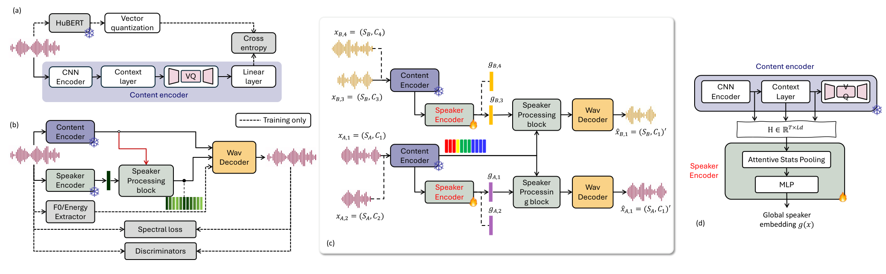

# VOSSA: Voiceprint Optimization for Streaming Speech Architectures (Interspeech 2026)

<a href="https://arxiv.org/abs/2609.38887">
  
</a>
<a href="https://morris88826.github.io/VOSSA/"></a>
<br>

This is the official repository for the paper

"VOSSA: Voiceprint Optimization for Streaming Speech Architectures"

by [Mu-Ruei Tseng](https://github.com/Morris88826), [Waris Quamer](https://github.com/warisqr007), [Ghady Nasrallah](https://github.com/Ghadynasrallah), [Ricardo Gutierrez-Osuna](https://scholar.google.com/citations?user=UnuQfEwAAAAJ&hl=en)

Department of Computer Science & Engineering, Texas A&M University

## News
**Sep. 2026:** VOSSA received the Best Student Paper Award at Interspeech 2026.

**Jun. 2026:** VOSSA accepted at Interspeech 2026.

## Introduction



Real-time voice conversion (VC) systems commonly rely on pretrained speaker embeddings from automatic speaker verification (ASV) models. While effective for speaker discrimination, these embeddings are trained to remain stable across phonetic and prosodic variations within-speaker, which may conflict with frame-level acoustic generation in streaming constraints. To address this issue, we propose VOSSA, a speaker representation framework that extracts speaker information from intermediate content encoder layers and aggregates using attentive statistics pooling. The embedding is trained jointly with VC objectives, removing the need for a separate speaker encoder.

For more information, please check out our [Demo Page](https://morris88826.github.io/VOSSA/).

## Highlights
- **Real-time streaming** with RTF ≈ 0.25 and end-to-end latency ≈ 73 ms
- **Best normalized target-speaker similarity** across six evaluation datasets
- **Improved pitch accuracy** — lowest pitch MAE and highest Pearson CC among all baselines
- **Better vowel preservation** — lowest Wasserstein distance to ground-truth F1 distributions for high, mid, and low vowels

## Code

The implementation follows the paper: a frozen streaming content encoder (TVTSyn backbone), a speaker embedding pooled from its intermediate layers, a time-varying timbre module, and a decoder trained with the dual-path (reconstruction + voice conversion) protocol.

### Installation

Tested with Python 3.10, PyTorch 2.8 and CUDA 12.8.

```bash
git clone https://github.com/Morris88826/VOSSA.git
cd VOSSA

conda create -n vossa python=3.10
conda activate vossa

pip install torch==2.8.0 torchaudio==2.8.0 --index-url https://download.pytorch.org/whl/cu128
pip install -r requirements.txt
```

### Pretrained checkpoints

The checkpoints are hosted on the [Hugging Face Hub](https://huggingface.co/morris88826/VOSSA) and downloaded automatically on first use:

```python
from src.pretrained import load_vossa

model = load_vossa()                            # downloads and caches the checkpoints
model = load_vossa(local_dir="checkpoints")     # or load files already on disk
```

To download all checkpoints into `checkpoints/` (needed for training):

```bash
hf download morris88826/VOSSA --local-dir checkpoints
```

### Inference

- `notebooks/inference.ipynb`: offline (whole-utterance) conversion and normalized speaker similarity.
- `notebooks/inference_streaming.ipynb`: chunk-by-chunk streaming conversion, with latency and real-time factor.

Streaming in a few lines:

```python
from src.pretrained import load_vossa
from src.streaming import VossaStreamer

model = load_vossa()

streamer = VossaStreamer(model, chunk_frames=3, lookahead=0)   # 60 ms chunks
session = streamer.session(target_audio)                       # 16 kHz reference of the target speaker
for block in source_blocks:                                    # blocks of any size
    out = session.push(block)
out = session.flush()
```

Each session keeps its own state, so several streams can share one model. Run `python -m src.streaming.check_parity` to verify the streaming path.

### Training

Training uses LibriTTS as the source corpus and VoxCeleb1/2 as target speakers. See [data/README.md](data/README.md) for preprocessing, metadata and the expected folder layout.

Set the dataset paths in `configs/data/resynthesis.yaml` and the GPUs in `configs/model/vossa_synthesizer.yaml`, then run:

```bash
python src/main.py fit -c configs/model/vossa_synthesizer.yaml -c configs/data/resynthesis.yaml
```

The content encoder and vocoder are loaded from `checkpoints/` (see [Pretrained checkpoints](#pretrained-checkpoints)) and kept frozen. Logging uses Weights & Biases.


## Citation
```
@inproceedings{tseng26c_interspeech,
  title     = {{VOSSA: Voiceprint Optimization for Streaming Speech Architectures}},
  author    = {Mu-Ruei Tseng and Waris Quamer and Ghady Nasrallah and Ricardo Gutierrez-Osuna},
  year      = {2026},
  booktitle = {{Interspeech 2026}},
  pages     = {4716--4720},
  doi       = {10.21437/Interspeech.2026-2763},
  issn      = {2958-1796},
}
```
